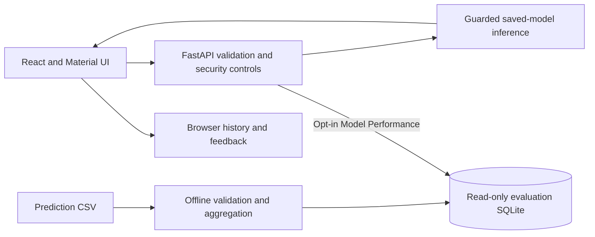

# AI-GeneratedContentDetection
A group project developed for COS30049 – Computing Technology Innovation Project at Swinburne University of Technology

## Run the application

Use **64-bit Python 3.12** and **Node.js 20.19.x or >=22.12.0**. The committed classifiers are ready to use; running the app does not require retraining or replacing models.

Windows also requires the Microsoft Visual C++ Redistributable (x64 for a 64-bit x86 Python installation); see the [backend prerequisites](backend/README-backend.md#installation-and-startup).

From the repository root, **Windows PowerShell**, terminal 1:

```powershell
cd backend
py -3.12 -m venv .venv
.\.venv\Scripts\python.exe -m pip install -r requirements.txt
.\.venv\Scripts\python.exe -m nltk.downloader punkt punkt_tab
.\.venv\Scripts\python.exe -m uvicorn app.main:app --host 127.0.0.1 --port 8000 --no-server-header
```

**Linux Bash**, terminal 1 (Python 3.12, venv support and the OpenMP runtime must be installed):

```bash
cd backend
python3.12 -m venv .venv
source .venv/bin/activate
python -m pip install -r requirements.txt
python -m nltk.downloader punkt punkt_tab
python -m uvicorn app.main:app --host 127.0.0.1 --port 8000 --no-server-header
```

For **Windows Git Bash**, create the environment with `py -3.12 -m venv .venv`, activate with `source .venv/Scripts/activate`, then use the same `python` commands. The uvloop platform marker skips it automatically on Windows.

Terminal 2, from the repository root (PowerShell or Bash):

```bash
cd frontend
npm ci
npm run dev
```

Open **http://localhost:5173**. API docs: **http://localhost:8000/docs**. Detailed prerequisites, configuration and checks: [backend README](backend/README-backend.md) and [frontend README](frontend/README.md). The frontend's optional `.env.example` supplies the default API URL; no manual dependency edits are needed.

## Architecture and submission documentation



The live and precomputed flows share the existing score transformation, while remaining separate workflows. Models, thresholds and prediction calculations are preserved.

- [API schemas, threat model and limitations](backend/README-backend.md#api-contracts-and-errors).
- [Section 2.7 defences](backend/README-backend.md#defences-submitted-for-marking): **Advanced — denial of service**; **Intermediate — misconfiguration and vulnerable dependencies**.
- [Section 2.8 Unicode experiment and reproducible commands](backend/README-backend.md#section-28--repeated-unicode-evasion-experiment).
- [Harvard references and team AI declaration placeholders](backend/README-backend.md#references-harvard-style). The team must complete the declaration from its actual records.
- [Dated verification, evidence locations and remaining submission actions](FINALISATION.md).

Both experiment scripts require explicit `--run-local`, use bounded local execution, omit passage text from results and write ignored evidence to `backend/experiments/results/`. No successful result should be claimed without its actual run/configuration. Dataset access is disabled by default; public exposure requires distribution permission and access controls. CORS is not authentication.

## Optional offline data-processing libraries

The following historical workflow is for regenerating datasets/training outputs, **not application installation**. It is not needed for submission startup or the security experiments, and does not change the saved models unless explicitly run.

Run the optional offline commands below from the repository root.

Install the required third-party libraries and the spaCy English language model:

```powershell
python -m pip install pandas scikit-learn nltk spacy matplotlib xgboost joblib numpy
python -m spacy download en_core_web_sm
```

| Library | Purpose |
| --- | --- |
| pandas | Read, clean, and save datasets |
| scikit-learn | Dataset splits, scaling, logistic regression, clustering, PCA, and evaluation |
| nltk | Split documents into sentences |
| spacy | Tokenisation, part-of-speech tagging, and stopword detection |
| matplotlib | Save charts and evaluation plots |
| xgboost | Train the boosted-tree classifier |
| joblib | Save models, scalers, and prediction metadata |
| numpy | Calculate cumulative PCA explained variance |

Note: Data processing downloads NLTK's `punkt` and `punkt_tab` resources automatically, so internet access is needed for the first download.

## Run data processing

Place the source dataset at `data/rawdata.csv`. It must contain these columns:

| Column | Expected contents |
| --- | --- |
| `text` | English document text |
| `label` | Numeric class label: `0` for human, `1` for AI-generated |
| `prompt_name`, `source`, `RDizzl3_seven` | Metadata columns required by the current script; their values are discarded |

Run:

```powershell
python DataProcessing.py
```


Outputs:

- `data/train_sentences.csv`, `data/test_sentences.csv`, and `data/val_sentences.csv`: sentences, labels, document IDs, and extracted features.
- `Class_Distribution.png`: class counts after document cleaning.
- Terminal output: split sizes, label proportions, sentence counts, and processing progress.

## Run model evaluation

Run data processing first, or use existing sentence CSVs with the same columns and all 12 features listed in `ModelEvaluation.py`. Run using:

```powershell
python ModelEvaluation.py
```


Outputs:

- `Models/`: `scaler.pkl`, `LogisticModel.pkl`, `KmeansModel.pkl`, `KmeansScaler.pkl`, `XGBModel.pkl`, and `metadata.pkl`.
- `model_evaluation/`: confusion matrices, cluster and PCA plots, precision-recall curves, and a model comparison chart.
- Terminal output: evaluation metrics, selected parameters and thresholds, cluster summaries, and XGBoost feature importance.

## Export saved-model predictions

Run this separate script using the existing processed datasets and saved models:

```powershell
python ExportModelPredictions.py
```

It saves `data_visualisations/model_predictions.csv`, combining training, validation, and test sentences. All original columns (features, `doc_ID`, `label`, sentence text, and any other metadata) are preserved, with three added columns:

- `split`: `Training`, `Validation`, or `Test`.
- `logistic_ai_probability`: logistic regression's estimated probability of AI-generated text.
- `xgboost_ai_probability`: XGBoost's estimated probability of AI-generated text.

Both probabilities range from 0 to 1 without thresholds or explicit rounding. The script reuses the saved scaler for logistic regression and unscaled features for XGBoost, in the saved feature order. It does not retrain models. Training estimates are in-sample; keep splits separate when assessing performance.

Use `--data-dir`, `--model-dir`, or `--output` to override the defaults. Reruns overwrite the output CSV. `DataVisualisation.py` remains a separate script for exploratory charts and summaries.

## Model Performance and Dataset Explorer

Open `/model-performance` from the sidebar, the mobile **Models** button, or the homepage. This is separate from individual analysis results. It offers:

- **Overview:** split/model/evaluation-level controls, metrics, clickable confusion matrices and score distributions by actual label. Defaults to Test, XGBoost, Document.
- **Dataset Explorer:** combined label/prediction/outcome/agreement/score filters, document-ID and sentence-word search, sortable pages, and document inspection with both models, sentence progression, raw probabilities and writing-style features.
- **Model Comparison:** both models on the identical split and level, grouped metric bars, matrices and clickable agreement groups.

### Import and run locally

Generate `data_visualisations/model_predictions.csv` with `ExportModelPredictions.py` first. Use the **same model generation** as `backend/Models/metadata.pkl`; the importer verifies that metadata against `backend/model_checksums.json`. A CSV does not itself prove which model generation produced it. If you retrain, regenerate the export and update the backend models/checksums together before importing.

From the repository root, in **Git Bash**:

```bash
cd backend
./.venv/Scripts/python.exe scripts/import_model_performance.py
export AIDETECT_PERFORMANCE_ENABLED=true
./.venv/Scripts/python.exe -m uvicorn app.main:app --host 127.0.0.1 --port 8000 --no-server-header
```

Or in **PowerShell**:

```powershell
cd backend
.\.venv\Scripts\python.exe scripts/import_model_performance.py
$env:AIDETECT_PERFORMANCE_ENABLED = "true"
.\.venv\Scripts\python.exe -m uvicorn app.main:app --host 127.0.0.1 --port 8000 --no-server-header
```

Start the frontend in another terminal with `cd frontend` then `npm run dev`; visit `http://localhost:5173/model-performance`. You may instead set `AIDETECT_PERFORMANCE_ENABLED=true` in the ignored `backend/.env` and restart the backend. Access defaults to **disabled**, even if a database is present. Keep this disabled on public deployments unless you have confirmed permission to distribute the dataset text and arranged appropriate access controls; this API has no user accounts. The commands above bind the API to loopback only.

The import command supports `--csv PATH` and `--output PATH`. For a custom database location, set `AIDETECT_PERFORMANCE_DB` to that same absolute path. Re-import after changing the export or saved metadata. Stop the server before replacing an open database on Windows. Imports are atomic: validation failures preserve the previous database. Missing, disabled, unreadable or metadata-mismatched datasets show an unavailable state rather than substitute results.

### Data and scoring

The importer streams and validates IDs, labels, split membership, probabilities and all 12 features. It rejects missing/non-finite/out-of-range probabilities, negative/non-finite features, inconsistent document labels, IDs shared across splits, and differing values for the same sentence text within a document. Identical repeated rows are **preserved and counted**, not deduplicated, because there are no original sentence IDs to distinguish genuine repetition from an export duplicate. Positions follow CSV order within each document.

The current local export contains 781,485 retained sentences across 44,862 documents, including 2,355 identical repeated rows. Counts are recomputed on each import. The generated SQLite snapshot is approximately 826 MiB for this export (including indexes and full-text search), and is ignored by Git. Importing takes several minutes and requires room for a temporary snapshot as well as any previous database. No dataset is bundled into frontend assets.

For each model's saved threshold `t`, raw probability `p` becomes `p/(2*t)` below `t`, or `0.5 + (p-t)/(2*(1-t))` otherwise. This is the **same shared function as live inference**. A document score is the mean of its retained sentence scores; a score at least 0.5 predicts AI. Each document counts once in document-level metrics. Sentence flags compare raw probabilities against the saved threshold. The UI distinguishes raw probabilities, re-centred scores, supplied labels, predictions and correctness. Re-centred scores are not calibrated authorship probabilities.

AI is the positive class. Undefined metrics are returned as null and shown as “Not defined”; zero remains zero. ROC-AUC needs both classes; average precision needs at least one positive label. Both use continuous scores. Matrix percentages use **all examples in the selected split and level** as the denominator. Histogram bins include their lower boundary and exclude their upper boundary, except the final bin includes 1. Agreement means identical binary predictions; “both incorrect” therefore also counts as agreement.

Test results are held-out; Training is in-sample; Validation was used in selection. All splits combined are not an independent generalisation estimate. Labels are supplied ground truth, not independently verified authorship, and results may differ on unseen writing. Preprocessing removed short sentences, so document inspection shows retained analysed sentences, not necessarily the entire original document. Repeated rows contribute to sentence metrics and document averages.

### Architecture and API

`backend/scripts/import_model_performance.py` builds `backend/data/model_performance.sqlite3`, with indexed sentence/document records, full-text search, source/metadata fingerprints, import information and cached split/level summaries. Requests only query saved predictions; they do not run inference. The database is opened read-only per query. Search matches document-ID substrings or sentence word prefixes; multiple text words must occur in one sentence. IDs sort alphabetically. Results are capped at 100 rows per request; document text/features are paginated. Previous/next document buttons navigate the current results page; closing preserves filters and pagination. Numeric sentence progression covers all retained sentences in that document.

All endpoints are under `/api/model-performance`:

| Endpoint | Purpose |
| --- | --- |
| `GET /status` | Availability and validated import provenance; no text when disabled |
| `GET /summary?split=Test&level=document` | Cached metrics, matrices, histograms and agreement for both models |
| `GET /records` | Validated combined filters, stable sort, bounded pagination |
| `GET /documents/{document_id}?page=1` | Both document predictions, sentence page with features, numeric progression |

Explorer filters are retained in the URL. Matrix/agreement clicks preserve split and level, select the relevant model, and clear old explorer filters so the count matches the selected group. Overview/comparison metrics cover the selected split and level, not additional explorer filters. No confidence intervals or feature-attribution/SHAP claims are provided.

### Verification

```bash
# From backend, with requirements-dev.txt installed:
./.venv/Scripts/python.exe -m pytest -q
# From frontend:
node --test src/lib/dashboard.test.js src/lib/performance.test.js
npm run build
```

Focused tests cover CSV validation, repetitions/conflicts, atomic imports, metadata mismatch and opt-in access, shared thresholds, document aggregation, sentence/document counts, metrics and undefined values, combined search/filters, model disagreements, sorting/pagination and matrix-to-explorer URL state. Existing analysis API and dashboard tests remain part of verification.
