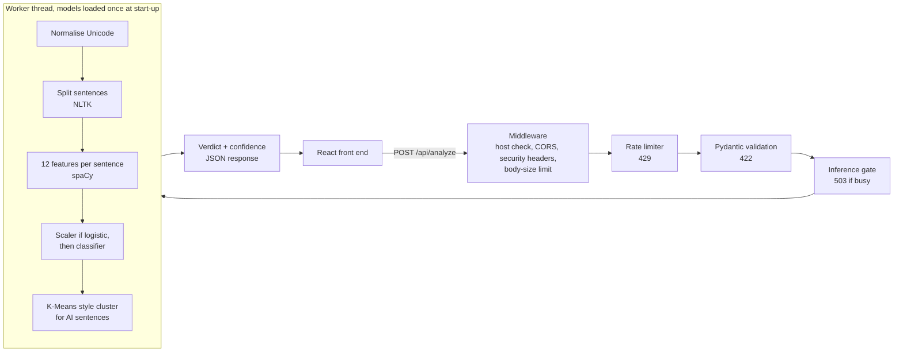

# AI Content Detector: Back End

FastAPI service that decides whether text is AI-generated or human-written, with a confidence score.
Interactive API documentation (every endpoint, with example requests and responses) is at `/docs` once the server is running.

## Setup and run

Requires Python 3.12.

```bash
cd backend
python3 -m venv .venv
source .venv/bin/activate              # Windows: .venv\Scripts\activate
pip install -r requirements.txt
python -m nltk.downloader punkt punkt_tab
uvicorn app.main:app --port 8000 --no-server-header
```

The server is ready when the log shows `Application startup complete`. API docs: http://localhost:8000/docs

Optional configuration (CORS origin, rate limit, etc.) is read from environment variables or a `.env` file; see `.env.example`. No secrets are required.

Tests: `pip install -r requirements-dev.txt && pytest -q`

If the models are retrained, run `python scripts/generate_checksums.py` once and commit `model_checksums.json`; the server refuses to start if a model file does not match it.

## Pinned dependencies

All versions in `requirements.txt` are pinned with `==`. Key versions:

| Package | Version |
|---|---|
| fastapi | 0.162.0 |
| starlette | 1.10.0 |
| pydantic | 2.14.1 |
| uvicorn | 0.54.0 |
| scikit-learn | 1.9.1 |
| xgboost | 3.4.1 |
| spacy (+ en_core_web_sm) | 3.8.18 (3.8.0) |
| nltk | 3.10.4 |
| numpy | 2.5.4 |
| pandas | 3.1.0 |
| joblib | 1.6.0 |

## Architecture



Each sentence gets a probability from the chosen model (XGBoost or logistic regression). Probabilities are re-centred so each model's saved threshold becomes 0.5, averaged across sentences, and the verdict is `ai_generated` at 0.5 or above. Confidence is `max(score, 1 - score)`. All errors use one JSON shape: `{"error": {"code", "message", "details"}, "request_id"}`.

## Threat model

**Who would attack it?** People who want AI-written text (essays, reviews, spam) to be judged human-made, and anyone who wants to copy the detector or take the service down.

**What do they want?** (1) Text that evades detection. (2) To learn how the model decides, by sending many probing requests. (3) To make the service slow or unavailable for others.

**What can they do?** Anyone can call the API directly, bypassing the front end. They can send look-alike or invisible Unicode characters to change what the model measures without changing what a person reads; send many requests quickly; send the largest, most expensive input allowed; and, if they could write to the server's files, replace a model file with a malicious one.

**Risks this design exposes:** denial of service (inference is far more costly than a request), detection evasion, missing rate limiting, unsafe model loading (models are pickle files), and misconfiguration / vulnerable dependencies.

**Risks that do not apply:** SQL injection (no database), command injection (no system commands are run), SSRF (the back end never makes requests based on input), unsafe file upload (input is JSON text only), broken access control (no user accounts).

## Defences to be marked

**Section 2.7**
1. **Denial of service (Advanced):** `app/concurrency.py`, used in `app/routes.py`
2. **Misconfiguration and vulnerable dependencies (Intermediate):** `app/middleware.py` (security headers, host check, docs switch), plus `pip-audit`, `npm audit` and OWASP ZAP

**Section 2.8 advanced security**
- **Detection evasion** (Unicode look-alikes): `app/sanitise.py`

Also implemented but not submitted for marking: rate limiting (`app/rate_limit.py`) and model-file hash checking (`app/integrity.py`).

## References

Chen, T. and Guestrin, C. (2016) 'XGBoost: a scalable tree boosting system', in *Proceedings of the 22nd ACM SIGKDD International Conference on Knowledge Discovery and Data Mining*. ACM, pp. 785–794.

Davis, M. and Suignard, M. (2023) *Unicode Technical Standard #39: Unicode security mechanisms*. Unicode Consortium. Available at: https://unicode.org/reports/tr39/

OWASP Foundation (2021) *OWASP Top 10:2021*. Available at: https://owasp.org/Top10/

Pedregosa, F. et al. (2011) 'Scikit-learn: machine learning in Python', *Journal of Machine Learning Research*, 12, pp. 2825–2830.

## Use of generative AI


<!-- VIDEO-CHECKLIST-START (delete whole section before submitting) -->

## Video checklist (temporary)

Max 15 minutes. Anything you want marked must appear in the video. Show real code, not just slides.

### Suggested running order
| Time | Section | Show |
|---|---|---|
| 0:00–1:00 | Who it's for and the problem | Who uses an AI-content detector and why |
| 1:00–4:00 | Live demo | Valid input, invalid input, error pages (404 and fallback), loading state, phone-sized layout |
| 4:00–7:00 | How the parts connect | Follow ONE request: React form → `routes.py` → `schemas.py` validation → `model_service.py` → response in `/docs` and in the UI. Say where validation and errors are handled |
| 7:00–9:00 | Key code and design decisions | `features.py` (identical to training), model loaded once in `main.py`, verdict maths, why sentence-level. Give alternatives you considered |
| 9:00–10:00 | Threat model | Summarise it before attacking anything |
| 10:00–14:00 | Attacks vs defences | See below. Show the attack WORKING without the defence, then FAILING with it |
| 14:00–15:00 | Limitations and next steps | What doesn't work yet (be honest) |

### Defence demos (attack your own app only, on your own machine)

**1. Denial of service (Advanced)**
```bash
# a) Defence OFF. Restart the server like this, then run the script below
AIDETECT_RATE_LIMIT_REQUESTS=100000 AIDETECT_INFERENCE_GUARD_ENABLED=false uvicorn app.main:app --port 8000 --no-server-header
# b) Defence ON. Restart normally (keep the high rate limit for the demo), run the same script
AIDETECT_RATE_LIMIT_REQUESTS=100000 uvicorn app.main:app --port 8000 --no-server-header
```
```python
# demo_dos.py  (python demo_dos.py)
import asyncio, time, httpx
text = ("The quick brown fox jumps over the lazy dog near the old river bank today. " * 200)[:10000]
async def main():
    async with httpx.AsyncClient(timeout=60, base_url="http://localhost:8000") as c:
        burst = [asyncio.create_task(c.post("/api/analyze", json={"text": text})) for _ in range(40)]
        await asyncio.sleep(0.05)
        lat = []
        for _ in range(12):
            t = time.perf_counter(); await c.get("/api/health")
            lat.append(round((time.perf_counter() - t) * 1000)); await asyncio.sleep(0.1)
        codes = [r.status_code for r in await asyncio.gather(*burst)]
        print("health latency (ms):", lat)
        print({k: codes.count(k) for k in set(codes)})
asyncio.run(main())
```
Expect: OFF, the first health check takes seconds and all 40 return 200 (the last user waits several seconds). ON, health stays in milliseconds and most of the 40 get 503.
Point at: `app/concurrency.py` (gate, queue limit, deadline), `routes.py` (worker thread). Explain the cost: real users can get a 503 during bursts.

**2. Misconfiguration and dependencies (Intermediate)**
```bash
curl -si localhost:8000/api/health | head -20        # security headers, no "server:" header
curl -s -o /dev/null -w '%{http_code}\n' localhost:8000/api/health -H 'Host: evil.com'   # 400
pip-audit -r requirements.txt
cd ../frontend && npm audit
# OWASP ZAP baseline scan against the running app, then fix or justify each finding
```
Point at: `app/middleware.py`. Justify any ZAP finding you leave