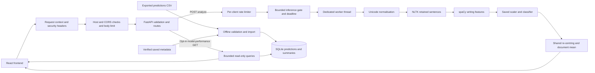

# AI Content Detector: Back End

FastAPI serves the existing XGBoost and logistic classifiers and an optional read-only Model Performance dataset. Scores describe model output, not verified authorship. Interactive documentation is at `http://localhost:8000/docs`; the machine-readable contract is `/openapi.json`.

## Installation and startup

Use **64-bit Python 3.12** and the committed models; no training is required. The frontend requires Node.js **20.19.x or >=22.12.0**. Node 24.14.0 was used for finalisation checks.

### Windows PowerShell

From the repository root:

```powershell
cd backend
py -3.12 -m venv .venv
.\.venv\Scripts\python.exe -m pip install -r requirements.txt
.\.venv\Scripts\python.exe -m nltk.downloader punkt punkt_tab
.\.venv\Scripts\python.exe -m uvicorn app.main:app --host 127.0.0.1 --port 8000 --no-server-header
```

No activation or execution-policy change is required. If the Windows Python launcher (`py`) is unavailable, use your Python 3.12 executable for the first command.

Windows also needs the **Microsoft Visual C++ Redistributable for the interpreter's architecture** (x64 for the setup tested here), as required by [XGBoost's installation guide](https://xgboost.readthedocs.io/en/stable/install.html). It may already be installed with Visual Studio or other applications. This OS runtime is separate from pip packages; install it before startup if absent.

### Linux Bash

Use a 64-bit Linux host with Python 3.12, its `venv` support and the OpenMP runtime (`libgomp.so.1`; package `libgomp1` on Debian/Ubuntu) installed:

```bash
cd backend
python3.12 -m venv .venv
source .venv/bin/activate
python -m pip install -r requirements.txt
python -m nltk.downloader punkt punkt_tab
python -m uvicorn app.main:app --host 127.0.0.1 --port 8000 --no-server-header
```

Native wheels depend on architecture and libc. Linux installation/runtime requires separate verification on a Linux host; Windows checks do not establish Linux compatibility.

### Windows Git Bash

```bash
cd backend
py -3.12 -m venv .venv
source .venv/Scripts/activate
python -m pip install -r requirements.txt
python -m nltk.downloader punkt punkt_tab
python -m uvicorn app.main:app --host 127.0.0.1 --port 8000 --no-server-header
```

`uvloop==0.23.0; sys_platform != "win32"` skips uvloop on Windows, which uses standard asyncio. No alternate requirements file or manual deletion is required. All other existing pins are retained. The spaCy English model is pinned by URL and SHA-256. NLTK resources are an explicit separate download; installation needs network access and a writable NLTK data location. For offline use, provision them first and set `NLTK_DATA`.

Wait for `Application startup complete`, then follow the [frontend setup](../frontend/README.md) in another terminal. Use `http://localhost:5173`, the default allowed origin.

Configuration comes from `AIDETECT_` environment variables or `backend/.env`; see `.env.example`. Start from `backend` for predictable `.env` lookup. Keep the inference guard, Unicode normalisation and rate limiting enabled in ordinary use. Evaluation access defaults to false. For deployment, set exact hosts/origins, hide docs as appropriate, and enable HSTS only with HTTPS. CORS and Host validation are not authentication.

### Verification

PowerShell, from `backend`:

```powershell
.\.venv\Scripts\python.exe -m pip install -r requirements-dev.txt
.\.venv\Scripts\python.exe -m pip check
.\.venv\Scripts\python.exe -m pytest -q
```

Bash, with the environment activated:

```bash
python -m pip install -r requirements-dev.txt
python -m pip check
python -m pytest -q
```

`pip check` tests installed dependency compatibility, not vulnerability absence. Re-run audits before submission. Model bytes are hash-checked before unpickling. Only regenerate checksums after an authorised model change, never to bypass a mismatch.

## Architecture



Model-specific thresholds come from saved metadata. Sentence probabilities are re-centred so each threshold becomes 0.5, then averaged. Documents scoring at least 0.5 predict AI. Confidence remains `max(score, 1-score)`, a heuristic strength, not a calibrated authorship probability. Scoring and model files are unchanged.

The evaluation importer does no training; its API queries do no inference. See the [root README](../README.md#model-performance-and-dataset-explorer) for import/provenance details. User analysis history and feedback remain in browser storage, separate from SQLite.

## API contracts and errors

| Endpoint | Contract |
| --- | --- |
| `GET /api/health` | `HealthResponse`; cheap liveness |
| `GET /api/model-info` | `ModelInfoResponse`; thresholds, models and input limits |
| `POST /api/analyze` | `AnalyzeRequest` → `AnalyzeResponse`; sentence and document predictions |
| `GET /api/model-performance/status` | Available provenance or unavailable reason; disabled/missing data returns 200 with `available=false` |
| `GET /api/model-performance/summary` | `PerformanceSummary`; both models on the same split/level, nullable metrics and agreement |
| `GET /api/model-performance/records` | `PerformanceRecords`; combined filters and bounded pagination |
| `GET /api/model-performance/documents/{document_id}` | `PerformanceDocument`; aggregate, sentence page with features and numeric progression |

`app/schemas.py` and `app/performance_schemas.py` drive Swagger. Query/path inputs have descriptions/examples. Evaluation response examples are **illustrative**, not dataset measurements. Null metrics mean undefined denominators/classes, not zero. Field names remain compatible with the frontend. Unavailable evaluation access returns 503 except on `/status`.

All application HTTP errors, including Host/CORS middleware rejections, share this envelope:

```json
{"error":{"code":"validation_error","message":"The request is not valid.","details":[]},"request_id":"illustrative-request-id"}
```

Statuses remain: 400 invalid headers/preflight; 404 missing route/document; 405 unsupported method; 413 oversized body; 422 invalid JSON/fields; 429 rate limit; 503 busy/unavailable/deadline; 500 unexpected exception. Appropriate Retry-After/CORS/security headers are retained. `X-Request-ID` matches the error-body ID. The envelope adapter preserves TrustedHost/CORS validation. Unexpected exceptions are logged server-side; responses expose no exception text, input text or internal paths. Malformed wire-level traffic rejected by Uvicorn/proxies before ASGI is outside this application envelope.

## Threat model

Attackers can bypass the UI and call HTTP endpoints directly. Objectives include exhausting inference, probing/copying the classifier, hiding AI text, reading evaluation data without permission, or exploiting configuration/model-file access.

| Risk | Mitigation and remaining exposure |
| --- | --- |
| Denial of service | Body/character/sentence limits, per-client rate limiting, worker pool, bounded gate/queue and cooperative deadlines. Legitimate bursts can be rejected. Limits are per process; public deployment also needs proxy quotas and resource monitoring. |
| Model probing | Rate limiting reduces volume but cannot prevent distributed probing/extraction. Public use needs authentication, quotas and abuse monitoring. |
| Unicode evasion | Normalise before feature extraction. The confusable map is incomplete and may alter legitimate accented/non-English text; it does not guarantee detection. |
| Unsafe model loading | Verify pickle bytes against committed SHA-256 values, then load those same bytes. Compromise of both the trusted manifest/code and models is outside this protection. |
| SQL injection | SQLite makes this a relevant risk. Values use bound parameters; model/sort/direction identifiers are validated enums mapped to controlled SQL. Search tokens are quoted and LIKE metacharacters escaped. |
| Evaluation text disclosure | API connections use `mode=ro` and `PRAGMA query_only=ON`; writes occur only in offline import. Read-only access does not make disclosure safe. Access defaults to disabled. Confirm distribution rights and add authenticated, authorised and audited access before public exposure. |
| Misconfiguration/vulnerable dependencies | Exact origins, trusted hosts, security headers, size limits, docs/HSTS switches, pinned packages and audits. Pins alone do not prove safety; triage advisories and scanner findings. |
| Browser storage/uploads | TXT/DOCX files are parsed in the browser; only JSON text reaches this API. Local history can contain sensitive text. No accounts is a deployment limitation, not proof that access-control risks are irrelevant. |

Production requests do not execute user-supplied shell commands or fetch user-supplied URLs. Experiment scripts launch fixed local commands separately. This reduces command-injection/SSRF exposure without replacing deployment review.

## Defences submitted for marking

### Section 2.7 — Advanced: denial of service

The attack sends concurrent permitted inputs that are expensive to analyse. `app/concurrency.py` and `app/routes.py` move inference out of the event loop, admit two running analyses plus four queued by default, reject overflow with 503, limit queue wait to two seconds and check an eight-second cooperative deadline. Rate limiting remains 20 analyses/minute/client. Legitimate requests may receive 429/503. Cooperative deadlines cannot forcibly interrupt every blocking model/NLP operation; process/proxy limits remain necessary.

`experiments/measure_dos.py` starts its own **loopback-only** child servers and compares guard-off/on with identical settings/workload. It never edits `.env` or the ordinary server. No external URL is accepted; proxy routing and redirects are disabled. Rate limiting stays enabled in both conditions. Each child performs one warm-up analysis, consuming one rate-limit slot, then is stopped or killed on completion.

From `backend`, using an activated environment in Bash (in PowerShell replace `python` with `.\.venv\Scripts\python.exe`):

```bash
python experiments/measure_dos.py --run-local --trials 2
```

Defaults: 12 requests, concurrency 8, 20 workload sentences, five-second request timeout, 30-second trial cap, up to 20 health probes and two counterbalanced trials per configuration. Hard caps: 64 requests, concurrency 16, 100 sentences, five trials, ten-second request timeout and 60-second trial duration. Child startup is capped at 60 seconds, numerical-library threads at one, with a shutdown kill fallback. The synthetic workload measures resources only; it has no authorship label. Avoid other heavy tasks during measurements.

Ignored outputs: `experiments/results/dos-<UTC timestamp>/requests.csv`, `summary.json` and local server logs. They contain attempted/success/429/503/other error/timeout/not-started counts, request and health latency distributions, successful-only latency, durations, settings and fingerprints. Text is omitted. Review logs before sharing. Fast rejection is not successful service; compare availability and rejection rates as well as latency. Client-slot wait is excluded. Fresh processes and counterbalanced trials reduce, but do not eliminate, hardware/cache/scheduling noise. No particular result is promised.

### Section 2.7 — Intermediate: misconfiguration and vulnerable dependencies

The attack exploits permissive origins, spoofed Hosts, verbose errors, exposed docs, missing headers or vulnerable packages. `app/middleware.py`, `app/config.py`, `app/errors.py`, integrity checks and pinned manifests implement the controls. Advisory scans and deployment review supply evidence; pinning alone is insufficient.

With a local server running, use `curl.exe` in PowerShell or `curl` in Bash:

```bash
curl -i http://127.0.0.1:8000/api/health
curl -i http://127.0.0.1:8000/api/health -H 'Host: evil.example'
python -m pip_audit -r requirements.txt
# From frontend:
npm audit
```

Record actual outputs/dates and triage findings. Run an OWASP ZAP baseline scan of the local API and production frontend preview as a separate manual evidence step; document findings and justifications. Scan only services you own. HSTS off for local HTTP and Swagger's restricted CDN/inline allowances are deliberate; review production transport/docs exposure.

### Section 2.8 — Repeated Unicode evasion experiment

`experiments/evaluate_unicode_evasion.py` compares original text with normalisation enabled, manipulated text with it disabled, and **the identical manipulation** with it enabled. All conditions use the same saved model/thresholds. Sequential conditions are counterbalanced, warmed up and deadline-limited inside a separate worker with a parent wall-clock cap. Ordinary server settings are untouched.

Use the imported database or a CSV containing `sample_id,text,label,split`. Labels are 0 human / 1 AI; empty labels are allowed but excluded from ground-truth success metrics. Splits: Test, Validation, Training, Unknown. CSV IDs must be unique; maximum input is 10,000 rows and 25 MiB. There is no fabricated labelled fallback. Experiment limits use explicit application defaults so inherited environment settings cannot silently widen the workload.

```bash
python experiments/evaluate_unicode_evasion.py --run-local --database data/model_performance.sqlite3 --split Test --model logistic --samples 8 --trials 2
# Alternative: authorised labelled passages
python experiments/evaluate_unicode_evasion.py --run-local --csv /path/to/passages.csv --split Test --model xgboost --samples 8 --trials 2
```

PowerShell uses the same options with `.\.venv\Scripts\python.exe`. SQLite selection is seeded and class-balanced, independent of predictions. It may use a retained-sentence prefix so every variant fits character/sentence limits; the manifest reports retained/exported counts. This is not necessarily complete original text. `--seed` controls selection. Three variants apply supported confusables, invisibles and both. Defaults: eight samples, two trials, 180 seconds; hard maxima: 50 samples, five trials, 600 seconds. Repeated deterministic inputs are not independent new samples.

**Attack success:** the objective is hiding known AI as human. Only labelled AI correctly detected at baseline enters the denominator; success requires the attacked verdict to become human. Already-missed AI, human passages and unknown labels are excluded. Introduced errors on either class, any classification flip, baseline restoration and restoration conditional on a flip are separate measures. A score change alone is not successful evasion. Undefined rates are null with zero denominators. Restoring a wrong baseline does not restore ground-truth accuracy.

Ignored outputs under `experiments/results/unicode-<UTC timestamp>/`:

- `results.csv`: IDs/labels, original/attacked/defended predictions and scores, suspicious counts, score changes, flip/error/restoration indicators and timing. No passage text.
- `summary.json`: explicit denominators, rates, mean/median/p95/standard deviations, timing overhead, per-variant/per-sample summaries, provenance and incomplete-condition errors.
- `score_changes.svg`: standalone numerical plot containing no text samples or IDs.

Timing includes full inference, not just normalisation. The manipulation map is a limited supported subset; this does not establish resistance to arbitrary Unicode/paraphrase attacks. Normalisation may damage legitimate non-English writing. Supplied labels are not independently verified. Training/Validation must not support claims of independent generalisation. Review source rights and identifiers before sharing outputs. Experiments do not run during normal tests or startup.

## Known limitations and submission actions

- Public deployment requires authenticated/authorised dataset access, permitted distribution, TLS, proxy/resource controls and monitoring. Cross-instance rate limits and hard process memory caps are not implemented.
- False positives/negatives and dataset shift remain. Neither an audit nor these small experiments guarantees security.
- Use the dated finalisation record for checks actually executed. Linux installation, ZAP and final video/report evidence require separate execution where not recorded.
- Team members must complete the declaration below, select permitted evidence and describe null or unsuccessful attacks honestly.

## References (Harvard style)

Chen, T. and Guestrin, C. (2016) ‘XGBoost: a scalable tree boosting system’, *Proceedings of the 22nd ACM SIGKDD International Conference on Knowledge Discovery and Data Mining*, pp. 785–794. doi:10.1145/2939672.2939785.

Hadley, J. and Pournader, R. (eds.) (2026) *Unicode Technical Standard #39: Unicode security mechanisms*, revision 34. Unicode Consortium. Available at: https://www.unicode.org/reports/tr39/tr39-34.html (Accessed: 10 November 2026).

OWASP Foundation (2023) *API4:2023 Unrestricted Resource Consumption*. Available at: https://api-security.owasp.org/editions/2023/en/0xa4-unrestricted-resource-consumption/ (Accessed: 10 November 2026).

OWASP Foundation (2021) *OWASP Top 10:2021*. Available at: https://owasp.org/Top10/2021/ (Accessed: 10 November 2026).

Python Packaging Authority (n.d.) *Dependency specifiers*. Available at: https://packaging.python.org/en/latest/specifications/dependency-specifiers/ (Accessed: 10 November 2026).

XGBoost developers (n.d.) *Installation guide*. Available at: https://xgboost.readthedocs.io/en/stable/install.html (Accessed: 10 November 2026).

Pedregosa, F. et al. (2011) ‘Scikit-learn: machine learning in Python’, *Journal of Machine Learning Research*, 12, pp. 2825–2830.

## Generative AI declaration — team confirmation required

Replace these placeholders with the team's actual records before submission. This does not assert who used a tool or what was independently verified.

- **Tools/models and dates:** [team to confirm].
- **Assisted tasks and affected files/sections:** [team to confirm].
- **Prompts/interaction records retained:** [team to identify permitted evidence location].
- **Human review, edits and checks actually performed:** [name reviewer and checks; do not infer verification].
- **Attribution and institutional disclosure requirements:** [team to confirm compliance and final wording].
